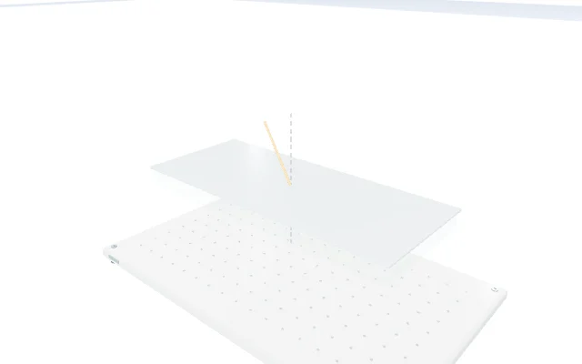
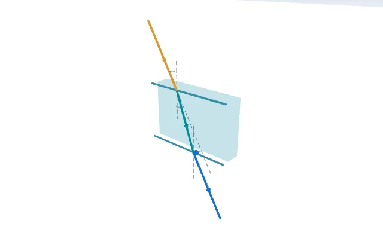
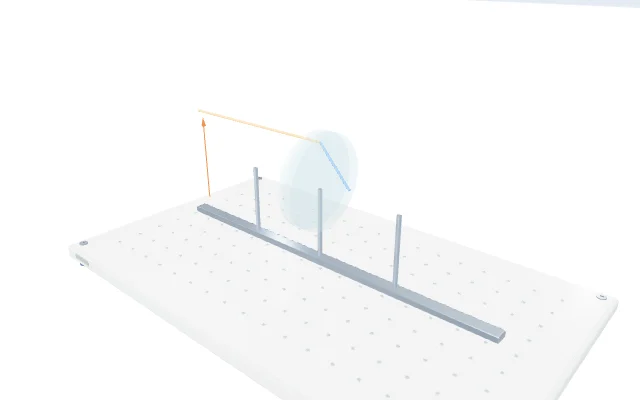
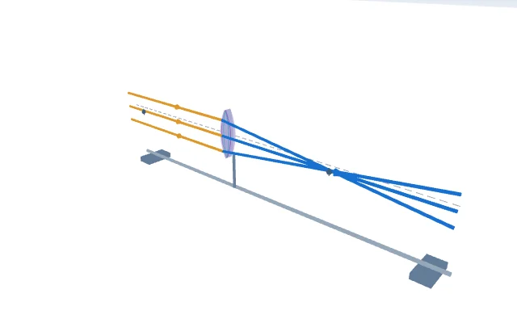
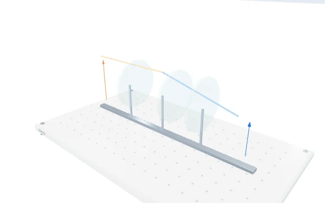
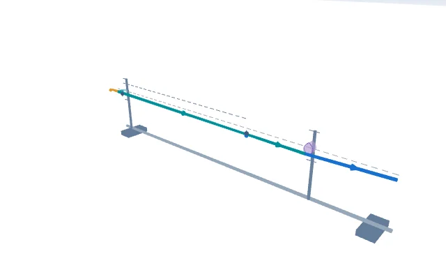

# Quanh Lab — quang học và độ rõ của mô phỏng v65

Ngày: 26/10/2026. Mốc trước thay đổi: `1d7070ffdd941f8a8a7a4ac1434c39b2a2ee1ea6` (v64). Nhánh: `feat/optics-clarity-v65`.

## Kết quả thực hiện

Đợt này thiết kế lại phần hình học và dụng cụ của **11 thí nghiệm quang học**: bản mặt song song, độ sâu biểu kiến, góc Brewster, gương quay, góc nhận sợi quang, độ tụ, hệ kính sát nhau, kính lúp, kính thiên văn, kính hiển vi và ảnh qua lỗ nhỏ. Các tia có chiều truyền, màu theo vai trò và đường kéo dài ảo nét đứt. Chú giải VI/EN nằm ngoài không gian mô hình, có thể thu gọn.

Các ID tương ứng: `ray_slab`, `apparent_depth`, `brewster`, `mirror_rotation`, `fiber_acceptance`, `lens_power`, `lenses_contact`, `magnifier`, `telescope`, `microscope`, `pinhole`.

Cộng với phạm vi v64, hiện **132 ID đã được cải tiến theo từng hiện tượng; 168 ID chưa được thiết kế lại riêng**. Đây không phải tuyên bố toàn bộ 300 mô hình đã được nghiệm thu khoa học.

## Audit và lỗi đã xử lý

| Mức | Vấn đề | Thay đổi thực tế |
| --- | --- | --- |
| P1 | Hình quang học chung chưa thể hiện đầy đủ đường tia, dấu ảnh và cấu hình dụng cụ | Tách bộ tính hình học thuần khỏi renderer; dựng riêng 11 bài và kiểm lại từ đầu mút tia thật |
| P1 | Hệ kính tổng độ tụ bằng 0 dễ bị hiểu thành tiêu điểm hữu hạn | Chùm ló song song, không tạo ảnh/tiêu điểm hữu hạn; giữ số đọc không xác định và hàng dữ liệu `null` |
| P1 | Đồ thị điện thế hai nguồn có thể nối qua cực giữa các mẫu đều | Chèn điểm cắt đúng tọa độ điện tích; không vẽ qua chỗ không xác định, không tạo giá trị 0 thay thế |
| P1 | Tên tham số rig chồng lên sơ đồ ở mặt trước 2D | Chỉ ẩn caption bị chồng trong 2D của 11 bài; giữ handle, ô nhập và nhãn khi về 3D |
| P2 | Tên trục tiếng Anh hiện mã biến và số mũ dài khó đọc | Tên trục tường minh cho 61 quan hệ; ký pháp khoa học gọn ở vạch chia; không làm tròn số tính hoặc số đo đã lưu |
| P2 | Texture chữ vẫn được cấp cho các đồ thị 3D đã ẩn | Bỏ texture không hiển thị, giữ dữ liệu/buffer và 95 biểu đồ HTML/SVG |
| P2 | Chuyển màu VI/EN tạo khoảng tương phản thấp thoáng qua | Đổi màu chữ/nền ngay lập tức; chỉ giữ chuyển động bóng focus |
| P2 | Ảnh thư viện cần theo mô hình hiện hành | Xuất lại **300 ảnh WebP 640×400** từ LabScene; tổng 1.748.742 byte, tải lazy, trang chủ không tải WebGL |

Không ghi nhận P0 trong phạm vi kiểm tra này. Điều đó không chứng minh toàn bộ hệ thống không còn lỗi nghiêm trọng.

## Thiết kế và kiến trúc

Giữ hệ font Manrope, tokens, khoảng cách và thành phần hiện có. Không sửa banner hố đen, CSS tiêu đề hai dòng, phương trình/catalog, kho sách hoặc schema lưu phiên.

- `optics-geometry-v65.js`: tọa độ, môi trường, tia, vật/ảnh, tiêu điểm và chú thích song ngữ; đầu vào bất biến.
- `optics-scenes-v65.js`: mesh/line có pool theo khóa; giữ geometry/material/buffer khi chạy và đổi tham số. Trục x/y dùng cùng tỉ lệ.
- `observation-view.js` / `observation.css`: chú giải native details, trạng thái ảnh, ghi chú; giữ trạng thái đóng/mở khi cập nhật.
- `relation-sampling.js`: lấy mẫu quan hệ liên tục/rời rạc và chia đoạn tại điểm không xác định.
- `observation-labels.js`: nhãn khoa học VI/EN và định dạng số hiển thị.
- Các màu tia có cùng định nghĩa ở renderer và legend: tới `#d98220`, trong môi trường `#087f89`, ló `#2468cc`, phản xạ `#ba4255`, kéo dài ảo `#8656bd`; nét đứt phân biệt đường dựng/ảo.

Không kéo giãn riêng trục y để làm vật nhỏ trông lớn hơn. Độ dày tia/kính, giá đỡ, đầu mũi tên và khe lỗ là ký hiệu đồ họa. Kính mỏng và độ sâu biểu kiến dùng xấp xỉ gần trục được nói rõ trong giao diện. Xem [hợp đồng khoa học](OPTICS_SCIENCE_V65.md).

## Kiểm thử và bằng chứng

| Kiểm tra | Kết quả / phạm vi |
| --- | --- |
| Khoa học độc lập | 381 trạng thái, 2.948 đoạn tia; 13 hash nguồn khoa học/catalog/phiên khớp baseline v64 |
| Renderer CPU | 58 trạng thái, 456 đoạn vẽ, 232 phép chiếu; thêm 192 cập nhật/132 đầu mũi tên và kiểm giữ resource |
| Chromium WebGL đầy đủ | 47/47 ca, 136 trạng thái, 1.066 tia dựng thực, 22 luồng tương tác |
| Chromium sau đóng băng nguồn mô hình | 27/27 ca, 24 trạng thái gồm góc tham số kết hợp của pinhole, 22 luồng tương tác, 10 luồng nhãn 2D |
| Thư viện | 13/13 ca, đủ 300 hash ảnh; 2.700 lượt giải mã ảnh qua 320/375/390/414/430/768/1024/1440/1920px |
| Quan hệ ngoài canvas | 320/390/1440px: điểm hiện tại, SVG ổn định, bảng mở theo nhu cầu, VI/EN, biến rời rạc/liên tục và cực điện thế |
| Axe tự động | 12 trạng thái VI/EN, hai bài đại diện, 320/390/1440px: 0 vi phạm phát hiện theo nhóm WCAG A/AA đã chạy; không phải chứng nhận WCAG |
| Sách sau thay locale pill | 24 ca, đủ ba lớp tại 320/390/1440px: giữ trang 39, zoom 150%, mục lục, ảnh và trang đã lưu; tương phản ngay sau đổi/100ms ≥16,427:1 |
| Bộ tích hợp | `npm run check`; kết quả lưu trong [bằng chứng](optics-v65/) |

Các ca trình duyệt ghi nhận 0 lỗi JavaScript chưa được bắt; bộ quang học không có HTTP lỗi nội bộ/request nhà cung cấp ngoài. Đo Play 1,25 giây/bài sau warm-up trên Chromium/SwiftShader: 0 geometry mới, trung vị cập nhật 0,3–1,3ms; có mẫu p95 31,6ms ở hệ kính. Đây là phép đo ngắn trên máy chủ, chưa chứng minh FPS/GPU điện thoại.

**Lưu ý về hash bằng chứng:** `optics-v65/renderer-source-hashes.json` là ảnh chụp của lượt QA trước khi hoàn thiện giao diện phát hành. Sau ảnh chụp đó, `dist/app.js` và `dist/observation-view.js` đã thay đổi; các tệp hình học và mô hình trong ảnh chụp không đổi. Không dùng danh sách hash cũ để xác nhận toàn bộ mã nguồn hiện tại. Lượt QA lại 27/27 trên mã phát hành và 12 hash tương ứng được ghi trong [PR #39](https://github.com/lequocanhaz/thi-nghiem-ao-thpt/pull/39).

Đã thực sự gọi các agent chuyên môn: `optics_physics`, `optics_ui`, `optics_qa`, `book_locale_review`. Agent chính tích hợp, kiểm tra chung và phụ trách phát hành. Bằng chứng chọn lọc, tên tệp thay đổi và ảnh ở [optics-v65](optics-v65/).

### Ảnh trước/sau cùng cấu hình mặc định

Ảnh trước lấy nguyên từ previews/v64, ảnh sau lấy từ previews/v65. Đây là ảnh xuất mô hình, không giả làm ảnh chụp toàn trang trước thay đổi.

| Bài | Trước | Sau |
| --- | --- | --- |
| Bản mặt song song |  |  |
| Hệ kính sát nhau |  |  |
| Kính hiển vi |  |  |

Ảnh giao diện mô hình có nhãn: [pinhole 390px](optics-v65/pinhole-390-2d.png), [kính thiên văn 1440px](optics-v65/telescope-1440-2d.png).

## Chưa nghiệm thu và bước tiếp theo

- 168 bài còn lại chưa thiết kế riêng; 20 mục khoa học PARTIAL của audit trước vẫn còn. Cần tiếp tục theo nhóm hiện tượng và có giáo viên phản biện.
- Chưa thử iPhone/Safari/Android thật, bàn phím ảo thật, GPU phần cứng hoặc hiệu năng dài hạn trên thiết bị yếu. Một số vật/ảnh rất nhỏ ở miền tham số cực đoan do giữ tỉ lệ vật lí; có hướng dẫn 2D/zoom.
- Firebase vẫn `enabled:false` theo yêu cầu chuẩn bị tích hợp. Chưa có dự án/provider/domain thực, chưa nghiệm thu email/Google OAuth và chưa có đồng bộ đám mây. Hướng dẫn: [AUTH_SETUP.md](AUTH_SETUP.md).
- Giấy phép thương mại sách/âm thanh, thử nghiệm lớp học, chính sách dữ liệu và điều kiện chuyển giao vẫn cần hoàn thiện. Không thêm thu tiền, analytics thu thập dữ liệu hoặc hệ thống bán hàng trong đợt này.
- Trạng thái CI, merge, Pages và kiểm tra HTTPS sau phát hành được ghi tại PR phát hành; chỉ coi website đã cập nhật khi workflow deploy thành công và asset/live-browser khớp bản mới.
